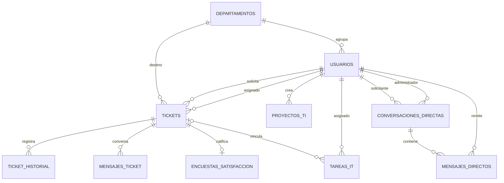

# Informe técnico del SGTI

**Fecha de elaboración:** 27 de septiembre de 2026  
**Alcance:** aplicación web, API, operaciones, configuración y estructura de datos que se puede comprobar en el repositorio.

## 1. Resumen del sistema

SGTI es una aplicación para registrar y gestionar solicitudes de soporte de IT. Tiene una interfaz web construida con React, una API HTTP con Express y una base de datos PostgreSQL. Los usuarios finales pueden registrarse, iniciar sesión, abrir tickets, consultar su estado, conversar con personal de IT y calificar tickets resueltos. Los perfiles administrativos pueden organizar tickets, asignarlos, publicar seguimientos, gestionar cuentas y administrar tareas, proyectos y configuraciones.

El backend usa consultas SQL parametrizadas con el paquete `pg`. Aunque hay un esquema de Prisma en el repositorio, el servidor de ejecución no usa Prisma Client: accede a PostgreSQL mediante un pool de `pg`.

## 2. Arquitectura y directorios

```text
SGTI/
├── INFORME_SGTI.md
├── .gitignore
├── backend/
│   ├── src/
│   │   ├── config/
│   │   ├── controllers/
│   │   ├── middleware/
│   │   ├── routes/
│   │   └── index.js
│   ├── migrations/
│   ├── prisma/
│   ├── scripts/
│   ├── package.json
│   └── prisma.config.ts
└── frontend/
    ├── public/
    ├── src/
    │   ├── components/
    │   ├── api.js
    │   ├── index.js
    │   └── tailwind.css
    ├── build/
    └── package.json
```

### Backend: función de cada archivo

| Archivo | Responsabilidad |
| --- | --- |
| `backend/src/index.js` | Punto de entrada usado por `npm start` y `npm run dev`. Configura Express, CORS y JSON, y monta las rutas de chat, autenticación, tickets y administración. Escucha en `PORT` o en el puerto 5000. |
| `backend/src/config/db.js` | Crea y exporta el pool PostgreSQL de `pg`, conectado por `DATABASE_URL`. |
| `backend/src/middleware/auth.js` | Firma y valida tokens HMAC, comprueba que el usuario siga activo en la base de datos y ofrece la protección por rol administrativo. |
| `backend/src/routes/authRoutes.js` | Declara la consulta pública de áreas, el registro y el inicio de sesión. |
| `backend/src/routes/ticketRoutes.js` | Declara operaciones autenticadas de tickets, historial, encuestas, asignación, resolución y mensajes. |
| `backend/src/routes/adminRoutes.js` | Declara operaciones de administración de usuarios, tickets, tareas, proyectos, calendario y configuración. |
| `backend/src/routes/chatRoutes.js` | Declara conversaciones directas y mensajes asociados a tickets. |
| `backend/src/controllers/authController.js` | Lista áreas disponibles, normaliza credenciales, autentica, registra usuarios finales con un área válida, almacena contraseñas con `scrypt` y actualiza contraseñas heredadas al iniciar sesión. |
| `backend/src/controllers/ticketAdvancedController.js` | Implementa lectura y creación de tickets, historial, encuestas, asignación, resolución y mensajes por ticket. |
| `backend/src/controllers/adminYUsuarioController.js` | Implementa las operaciones administrativas, métricas, seguimiento de tickets, calendario, tareas, proyectos y configuraciones. |
| `backend/src/controllers/chatController.js` | Lee y envía mensajes dentro de un ticket, comprobando acceso del solicitante o de un administrador. |
| `backend/src/controllers/directChatController.js` | Lista administradores y conversaciones directas, crea conversaciones al enviar mensajes y marca mensajes recibidos como leídos. |
| `backend/scripts/bootstrap-admins.js` | Provisiona las cuatro cuentas administrativas a partir de variables de entorno, comprobando las áreas y usando una transacción. |
| `backend/migrations/001_direct_chat.sql` | DDL de conversaciones directas y mensajes directos, incluidas sus restricciones e índice. |
| `backend/migrations/002_ticket_followup.sql` | Agrega a `tickets` los campos usados para fecha estimada, causa externa y actualización pública. |
| `backend/prisma/schema.prisma` | Describe dos modelos Prisma, `Ticket` e `HistorialTicketLog`. No describe toda la base que consulta la aplicación. |
| `backend/prisma.config.ts` | Configuración de Prisma para sincronizar instrucciones/skills de herramientas de desarrollo. No define el esquema PostgreSQL operativo. |
| `backend/package.json` | Dependencias y comandos del backend. El script de ejecución apunta a `src/index.js`. |

### Frontend: función de cada archivo

| Archivo | Responsabilidad |
| --- | --- |
| `frontend/src/index.js` | Crea el root React e inicia el componente `App`. |
| `frontend/src/components/App.jsx` | Contiene el estado principal, las vistas, la navegación por pestañas, las llamadas a la API y los formularios de la aplicación activa. |
| `frontend/src/components/Login.jsx` | Muestra el formulario de inicio de sesión y registro. |
| `frontend/src/api.js` | Centraliza `fetch` autenticado: recupera el token guardado en `localStorage` y lo envía como `Authorization: Bearer`. |
| `frontend/src/tailwind.css` | Incluye las capas base, componentes y utilidades de Tailwind CSS. |
| `frontend/public/index.html` | HTML inicial de la aplicación y nodo `root`. |
| `frontend/build/` | Salida compilada existente. Sus recursos son artefactos generados; el código mantenible está en `frontend/src/`. |
| `frontend/package.json` | Dependencias y comando de desarrollo de Create React App. |

El archivo `.gitignore` excluye dependencias, archivos de entorno y artefactos de compilación. Existe un `backend/.env` local; no se incluye su contenido en este informe por ser configuración sensible.

## 3. Perfiles y permisos

Los roles administrativos reconocidos por la API son:

| Rol | Área esperada |
| --- | --- |
| `gerente_it` | Gerencia de IT |
| `admin_infra` | Infraestructura |
| `admin_gps` | GPS/rutas |
| `admin_desarrollo` | Desarrollo |
| `usuario_final` | Usuario solicitante |

El registro público crea cuentas con rol `usuario_final`. Las rutas bajo `/api/admin` exigen un token válido y que el usuario tenga alguno de los cuatro roles administrativos. Las rutas de tickets y chat también exigen autenticación, y sus controladores limitan la consulta de tickets y conversaciones según el usuario.

## 4. Flujo completo de uso

### 4.1 Preparación y arranque

1. Disponer de una instancia PostgreSQL accesible y de las tablas base que utiliza el sistema. El repositorio no contiene un script completo para crear todas esas tablas; véase la sección de base de datos.
2. Configurar `DATABASE_URL` y una clave estable `AUTH_TOKEN_SECRET` para el backend. Se recomienda que esta clave tenga alta entropía y que se mantenga igual entre reinicios.
3. Instalar dependencias en `backend/` y `frontend/` ejecutando `npm install` en cada directorio.
4. Iniciar el backend desde `backend/` con `npm run dev` durante desarrollo o `npm start` para ejecución normal. Ambos comandos cargan `src/index.js`.
5. Iniciar el frontend desde `frontend/` con `npm start`.

**Puertos:** el backend usa `PORT` (5000 si no se configura) y el proxy de desarrollo del frontend apunta a `http://127.0.0.1:4000`; ambos valores deben coincidir. Con la configuración actual, el backend usa el puerto 4000.

### 4.1.1 Acceso desde la red local

El backend y el servidor de desarrollo del frontend escuchan en todas las interfaces de red. Para compartir el sistema con equipos conectados a la misma red:

1. Iniciar backend y frontend como se indica arriba en el equipo que alojará el sistema.
2. Consultar la dirección IPv4 local de ese equipo (`ip addr` en Linux o `ipconfig` en Windows).
3. Compartir `http://<IP-LOCAL-DEL-EQUIPO>:3000`; por ejemplo, `http://192.168.1.25:3000`.
4. Si no se puede abrir desde otro equipo, permitir conexiones entrantes al puerto 3000 en el firewall. El navegador usa el proxy del frontend para comunicarse con el backend.

Este enlace solo funciona mientras los dos servidores estén ejecutándose y los equipos tengan conectividad entre sí. Está pensado para una red de confianza; no se debe exponer a Internet sin HTTPS y controles de acceso adecuados.

### 4.2 Alta e inicio de sesión

1. Un usuario puede registrarse desde la pantalla de acceso con nombre, correo, contraseña de al menos ocho caracteres y un área elegida del catálogo actual de la base. El backend valida que el área exista.
2. El backend normaliza el correo, verifica duplicados y guarda la contraseña con `scrypt`, un salt aleatorio y la clave derivada.
3. El servidor devuelve un token firmado y los datos básicos del usuario. El frontend guarda ambos en `localStorage` bajo `sgti_user`.
4. En llamadas protegidas, el frontend añade el token Bearer. El backend verifica la firma y expiración y vuelve a consultar en la base de datos que la cuenta esté activa.
5. La sesión expira a las ocho horas. Al cerrar sesión, el frontend elimina los datos locales.

### 4.3 Flujo de un ticket

1. El usuario autenticado completa título, descripción, categoría, tipo de solicitud, prioridad y área destino.
2. El frontend envía `POST /api/tickets`. El backend verifica campos obligatorios y, para usuarios finales, revisa si `modo_mantenimiento` está activo.
3. El ticket se guarda con estado inicial `nuevo`, fecha límite proporcionada o, como alternativa, dos días después. Se registra la creación en `ticket_historial`.
4. El solicitante consulta sus tickets activos; los perfiles administrativos pueden consultar los tickets activos de todos.
5. Un administrador puede cambiar estado y área y asignar automáticamente al primer administrador activo de esa área. La asignación queda registrada en el historial.
6. El responsable asignado o el gerente puede publicar un seguimiento, una fecha estimada, una indicación de bloqueo externo y/o confirmar la resolución.
7. Al resolverse, el ticket deja las listas activas y aparece en el historial administrativo. El usuario puede calificarlo una sola vez, con una nota de 1 a 5 y un comentario opcional.

### 4.4 Mensajería y herramientas administrativas

- **Chat directo:** un usuario elige un administrador activo y envía mensajes. Un administrador consulta su bandeja por solicitante. Al abrir una conversación se marcan como leídos los mensajes recibidos. La interfaz refresca periódicamente mediante solicitudes HTTP; no usa WebSockets.
- **Chat de ticket:** el backend expone lectura y envío de mensajes asociados a un ticket. No se observó una pantalla activa de chat por ticket en `App.jsx`.
- **Usuarios:** el administrador crea cuentas, cambia rol, área y estado. La operación llamada eliminar desactiva la cuenta (`activo = FALSE`) en vez de borrar físicamente su registro.
- **Tareas:** el administrador crea, actualiza y elimina tareas internas, con fecha límite, estado y asignación.
- **Proyectos:** el administrador registra proyectos, cambia estado y descripción, o los elimina.
- **Calendario:** reúne tickets abiertos y tareas con fecha límite; es una vista de consulta.
- **Configuración:** guarda pares clave/valor. `modo_mantenimiento` impide la creación de tickets por usuarios finales; el ajuste de alertas por correo se guarda, pero no se encontró implementación de envío SMTP.
- **Métricas:** el panel calcula tickets asignados, resueltos, pendientes, vencidos y tasa de resolución para usuarios administrativos activos.

## 5. API HTTP

Todas las respuestas y los métodos se implementan en las rutas del backend. Salvo consulta de áreas, inicio de sesión y registro, las operaciones indicadas requieren autenticación. `/api/admin/*` requiere además un rol administrativo.

### Autenticación: `/api/auth`

| Método y ruta | Uso |
| --- | --- |
| `GET /api/auth/departamentos` | Listar las áreas disponibles para registro y formularios. |
| `POST /api/auth/login` | Iniciar sesión con correo y contraseña. |
| `POST /api/auth/registro` | Crear una cuenta de usuario final. |

### Tickets: `/api/tickets`

| Método y ruta | Acceso / uso |
| --- | --- |
| `GET /api/tickets` | Tickets activos propios; los administradores reciben tickets activos de todos. |
| `POST /api/tickets` | Crear ticket. |
| `GET /api/tickets/historial` | Historial de resueltos; solo administrador. |
| `GET /api/tickets/resueltos` | Tickets resueltos del usuario autenticado y estado de encuesta. |
| `POST /api/tickets/:id/encuesta` | Guardar una calificación de 1 a 5 para un ticket resuelto propio. |
| `PUT /api/tickets/:id/asignar` | Asignar ticket; solo administrador. |
| `PUT /api/tickets/:id/resolver` | Resolver ticket; solo administrador. |
| `POST /api/tickets/:id/mensajes` | Enviar mensaje del chat asociado al ticket. |

### Chat: `/api/chat`

| Método y ruta | Uso |
| --- | --- |
| `GET /api/chat/directo/admins` | Listar administradores disponibles para iniciar chat. |
| `GET /api/chat/directo` | Listar conversaciones del administrador o mensajes de la conversación seleccionada. El parámetro es `usuario_id` para admin o `admin_id` para usuario. |
| `POST /api/chat/directo` | Enviar mensaje directo; el cuerpo contiene `mensaje` y `usuario_id` o `admin_id`, según el rol. |
| `GET /api/chat/:ticket_id/mensajes` | Leer mensajes de un ticket con comprobación de acceso. |
| `POST /api/chat/:ticket_id/mensajes` | Enviar mensaje a la conversación del ticket con comprobación de acceso. |

### Administración: `/api/admin`

| Método y ruta | Uso |
| --- | --- |
| `GET /api/admin/usuarios` | Listar usuarios y sus áreas. |
| `POST /api/admin/usuarios` | Crear usuario o modificar el existente si el cuerpo incluye `id`. |
| `DELETE /api/admin/usuarios/:id` | Desactivar usuario; no permite desactivar la propia cuenta. |
| `GET /api/admin/tickets/eficiencia` | Métricas de tickets por administrador. |
| `GET /api/admin/tickets/todos` | Listar tickets activos con información de creador, responsable y semáforo de vencimiento. |
| `PUT /api/admin/tickets/:id/modificar` | Cambiar estado, área, datos del ticket o responsable; registra el cambio. |
| `PUT /api/admin/tickets/:id/seguimiento` | Publicar seguimiento, causa externa, fecha estimada o resolución. |
| `GET /api/admin/tareas` | Listar tareas. |
| `POST /api/admin/tareas` | Crear o actualizar tarea (con `id`). |
| `DELETE /api/admin/tareas/:id` | Eliminar tarea. |
| `GET /api/admin/proyectos-ti` | Listar proyectos. |
| `POST /api/admin/proyectos-ti` | Crear o actualizar proyecto (con `id`). |
| `DELETE /api/admin/proyectos-ti/:id` | Eliminar proyecto. |
| `GET /api/admin/calendario` | Listar eventos de tickets abiertos y tareas. |
| `GET /api/admin/configuraciones` | Leer configuración. |
| `PUT /api/admin/configuraciones` | Guardar uno o más ajustes como pares clave/valor. |

## 6. Base de datos

### 6.1 Motor y límites de lo documentado

La aplicación se conecta a PostgreSQL mediante `DATABASE_URL` y el pool de `pg`. Las consultas SQL muestran las tablas y columnas que necesita el código, pero el repositorio **no contiene el DDL base completo** de `usuarios`, `departamentos`, `tickets` y las demás tablas operativas. El directorio `backend/prisma/migrations/20260927000000_chat_directo/` está vacío. Por eso, este catálogo describe todo lo que se puede verificar en el código, pero no sustituye un volcado de esquema de la base realmente desplegada.

Además, `backend/prisma/schema.prisma` no coincide con el modelo operativo usado por los controladores: solo define `Ticket` y `HistorialTicketLog`, con nombres de campos distintos a los que usa el SQL de la API. El runtime no importa Prisma Client. Antes de usar Prisma para migrar o administrar la base, habría que reconciliar ese esquema con la base real.

### 6.2 Tablas operativas que aparecen en consultas

Los siguientes nombres y columnas se desprenden de consultas SQL del código. Las relaciones marcadas como “usada por código” se observan en los `JOIN`, filtros o claves foráneas; no se puede asegurar que estén declaradas todas como constraints en la base actual.

| Tabla | Columnas que el código usa | Propósito y relaciones observables |
| --- | --- | --- |
| `usuarios` | `id`, `nombre`, `email`, `password`, `rol`, `departamento_id`, `activo` | Cuentas, credenciales, permisos y asignación a área. `email` debe ser único por el manejo del error de duplicado. Se consulta contra `departamentos` y se referencia desde tickets, tareas, proyectos, historial y mensajes. |
| `departamentos` | `id`, `nombre` | Catálogo de áreas. El aprovisionamiento administrativo exige que ya existan los nombres de área esperados. |
| `tickets` | `id`, `titulo`, `descripcion`, `usuario_creador_id`, `departamento_destino_id`, `asignado_a_id`, `categoria`, `tipo_solicitud`, `prioridad`, `estado`, `fecha_limite`, `created_at`, `updated_at`, `fecha_resolucion`, `fecha_estimada_resolucion`, `causa_externa`, `actualizacion_publica` | Solicitudes de soporte. Se relaciona por consulta con solicitante, área destino y administrador asignado; se vincula con historial, encuestas, mensajes y, opcionalmente, tareas. |
| `ticket_historial` | `ticket_id`, `usuario_id`, `accion`, `created_at` (este último se usa para ordenar) | Registro de creación, asignaciones, modificaciones, seguimientos y resolución. |
| `encuestas_satisfaccion` | `ticket_id`, `calificacion`, `comentario` | Opinión sobre un ticket resuelto. El controlador impide registrar más de una encuesta por ticket mediante consulta previa; no se observa la definición de constraint única en los archivos disponibles. |
| `mensajes_ticket` | `ticket_id`, `remitente_id`, `mensaje`, `created_at` | Mensajes vinculados a tickets y remitentes. El controlador espera un identificador generado y ordena por fecha. |
| `tareas_it` | `id`, `ticket_id`, `asignado_a_id`, `titulo`, `descripcion`, `estado`, `fecha_limite` | Tareas internas, asignadas a usuarios y opcionalmente ligadas a tickets. |
| `proyectos_ti` | `id`, `titulo`, `descripcion`, `creado_por_id`, `estado`, `created_at` | Proyectos de IT, con creador y fecha de creación. |
| `configuraciones` | `clave`, `valor`, `updated_at` | Parámetros de sistema. El código hace `upsert` por `clave`, por lo que esta debe tener una restricción única o clave primaria. |
| `conversaciones_directas` | `id`, `solicitante_id`, `admin_id`, `created_at` | Conversación única entre un solicitante y un administrador. La migración declara ambas referencias a usuarios, unicidad del par y prohíbe que ambos IDs sean iguales. |
| `mensajes_directos` | `id`, `conversacion_id`, `remitente_id`, `mensaje`, `leido`, `created_at` | Mensajes de chat directo, asociados a conversación y remitente. La migración exige texto no vacío, inicia `leido` en falso y define índice por conversación y fecha. |

### 6.3 Esquema Prisma incluido

El esquema Prisma actualmente declara estos modelos y nombres de tabla:

**`Ticket` → tabla `tickets`:** `id` (entero autoincremental), `nombre_solicitante`, `departamento`, `ubicacion` (por defecto `Presencial`), `titulo`, `descripcion`, `categoria` (por defecto `hardware`), `tipo_solicitud` (por defecto `incidente`), `prioridad` (por defecto `media`), `urgencia` (por defecto `media`), `archivo_adjunto` opcional, `estado_actual` (por defecto `Abierto`), `agente_asignado` (por defecto `Auxiliar`), `fecha_creacion` (ahora), `fecha_limite_sla` opcional, `fecha_resolucion` opcional y `detalles_resolucion` opcional.

**`HistorialTicketLog` → tabla `historial_tickets_log`:** `log_id` (entero autoincremental), `ticket_id`, `nombre_solicitante`, `departamento`, `titulo`, `categoria`, `tipo_solicitud`, `prioridad`, `agente_asignado`, `detalles_resolucion` opcional y `archivado_en` (ahora).

Estos dos modelos no representan el contrato SQL actual de los controladores. Por ejemplo, los controladores esperan en `tickets` `usuario_creador_id`, `departamento_destino_id`, `estado` y `asignado_a_id`, en lugar de los campos equivalentes del modelo Prisma. `historial_tickets_log` no aparece usado por los controladores revisados; el historial operativo se escribe en `ticket_historial`.

### 6.4 Migraciones SQL versionadas

- `backend/migrations/001_direct_chat.sql`: crea `conversaciones_directas` con clave primaria serial, referencias en cascada a usuarios, fecha de creación, par solicitante/administrador único y restricción para que no sea la misma persona. Crea `mensajes_directos` con referencias en cascada a conversación y remitente, texto no vacío, marca de lectura, fecha de creación e índice `(conversacion_id, created_at)`.
- `backend/migrations/002_ticket_followup.sql`: agrega a `tickets` `fecha_estimada_resolucion TIMESTAMP`, `causa_externa BOOLEAN NOT NULL DEFAULT FALSE` y `actualizacion_publica TEXT`. Usa `ADD COLUMN IF NOT EXISTS`, por lo que se puede volver a ejecutar.

Las migraciones se encuentran en `backend/migrations/`, no dentro de la carpeta de migraciones de Prisma. Se aplican manualmente con `psql`; no hay un script `migrate` en `package.json`.

### 6.5 Relaciones funcionales



El diagrama resume relaciones funcionales inferidas del SQL. Solo las constraints de chat directo están declaradas explícitamente en las migraciones SQL disponibles.

## 7. Configuración y mantenimiento

### Variables de entorno observadas

| Variable | Uso |
| --- | --- |
| `DATABASE_URL` | Cadena de conexión PostgreSQL para el pool del backend y `psql`. |
| `AUTH_TOKEN_SECRET` | Clave HMAC para firmar sesiones. Debe ser estable entre reinicios. Si falta, el middleware genera una clave aleatoria al iniciar y las sesiones dejan de ser válidas al reiniciar. |
| `PORT` | Puerto HTTP del backend; predeterminado 5000. |
| `REACT_APP_API_BASE_URL` | URL base opcional del backend para el frontend; si se omite, las peticiones son relativas y dependen del proxy de desarrollo. |
| `ADMIN_GERENCIA_EMAIL`, `ADMIN_GERENCIA_PASSWORD` | Credenciales para provisionar `gerente_it`. |
| `ADMIN_INFRA_EMAIL`, `ADMIN_INFRA_PASSWORD` | Credenciales para provisionar `admin_infra`. |
| `ADMIN_GPS_EMAIL`, `ADMIN_GPS_PASSWORD` | Credenciales para provisionar `admin_gps`. |
| `ADMIN_DESARROLLO_EMAIL`, `ADMIN_DESARROLLO_PASSWORD` | Credenciales para provisionar `admin_desarrollo`. |
| `ADMIN_GERENCIA_NAME`, `ADMIN_INFRA_NAME`, `ADMIN_GPS_NAME`, `ADMIN_DESARROLLO_NAME` | Nombres opcionales para las cuentas administrativas; si faltan, se usa el nombre del área. |

Las contraseñas administrativas deben tener ocho caracteres o más. El script espera que ya existan en `departamentos` las áreas `Gerencia de IT`, `Infraestructura`, `GPS/rutas` y `Desarrollo`. Si el correo ya existe, actualiza nombre, rol, área y estado activo, pero conserva la contraseña existente.

### Comandos relevantes

Desde `backend/`:

```sh
npm install
npm run dev
npm start
npm run bootstrap:admins
psql "$DATABASE_URL" -v ON_ERROR_STOP=1 -f migrations/001_direct_chat.sql
psql "$DATABASE_URL" -v ON_ERROR_STOP=1 -f migrations/002_ticket_followup.sql
```

Desde `frontend/`:

```sh
npm install
npm start
```

Antes de aprovisionar administradores o iniciar los flujos de tickets, la base debe contar con las tablas base y los datos de áreas que el código espera. Las dos migraciones mostradas no crean ese esquema base.

## 8. Seguridad y límites funcionales observables

- Las contraseñas nuevas se guardan con `scrypt` y salt aleatorio. Se usa comparación de tiempo constante para hashes actuales. Si el valor almacenado no sigue el formato `scrypt`, el controlador intenta validarlo como texto plano y actualizarlo a hash al iniciar sesión; por ello, cualquier contraseña heredada en texto plano debe migrarse cuanto antes.
- Los tokens contienen ID, correo, rol y vencimiento, van firmados con HMAC SHA-256 y no están cifrados. Su firma permite detectar cambios, pero no ocultar el contenido. El middleware vuelve a leer el rol y estado activo del usuario en la base de datos.
- `AUTH_TOKEN_SECRET` no debe quedar sin configurar en producción: el valor aleatorio de respaldo cambia en cada reinicio.
- `cors()` está habilitado sin restricción explícita de origen en el servidor revisado.
- Las peticiones SQL observadas usan parámetros para los valores variables.
- El control de administrador central se aplica a todas las rutas `/api/admin`. Las rutas de tickets y chat tienen autenticación y controles adicionales en sus controladores.
- La API activa no ofrece carga de archivos adjuntos.
- El ajuste `alertas_email` se persiste y aparece en la interfaz, pero no se encontró un servicio SMTP que envíe alertas.

## 9. Observaciones antes de presentar o desplegar

1. **El esquema base de PostgreSQL falta en el repositorio.** Para afirmar que la base de datos está documentada al 100 %, hace falta obtener un esquema de la instancia (`pg_dump --schema-only`) o recuperar el DDL original. Este informe separa lo explícito de lo inferido.
2. **Prisma y el SQL operativo difieren.** Alinear `schema.prisma` y las migraciones con las tablas reales antes de usar Prisma para migraciones.
3. **La edición de tareas no permite cambiar su estado.** Ya permite editar título, descripción, fecha límite y responsable; para añadir opciones de estado sin arriesgar valores incompatibles, primero hay que confirmar el tipo y los valores válidos de `tareas_it.estado` en el esquema real.

## 10. Resumen para exposición

SGTI centraliza solicitudes de soporte de IT en tickets que tienen solicitante, área destino, prioridad, estado, fecha límite y responsable. Los usuarios crean y siguen sus solicitudes, conversan con el área técnica y califican el servicio una vez resuelto. El personal administrativo clasifica y asigna tickets, registra avances y resoluciones y utiliza herramientas complementarias de usuarios, métricas, tareas, proyectos, calendario y configuración. La aplicación se compone de React, Express y PostgreSQL; la API protege sesiones con tokens firmados y almacena contraseñas con hash. El repositorio, sin embargo, no incluye el DDL completo de la base operativa, por lo que para documentar la base desplegada sin inferencias se necesita exportar su esquema real.